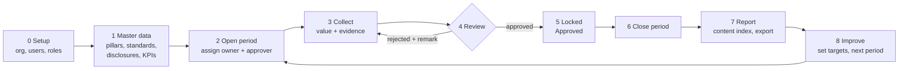
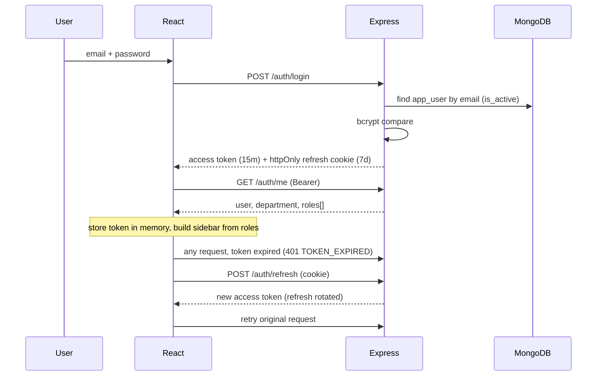
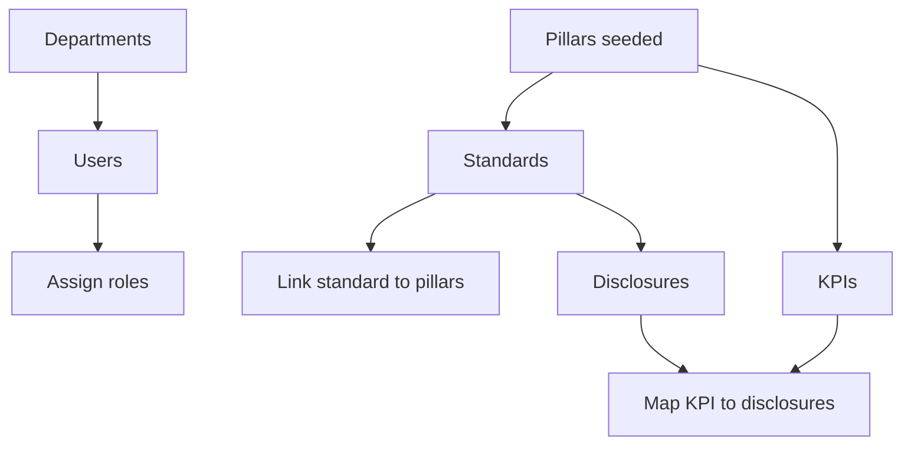
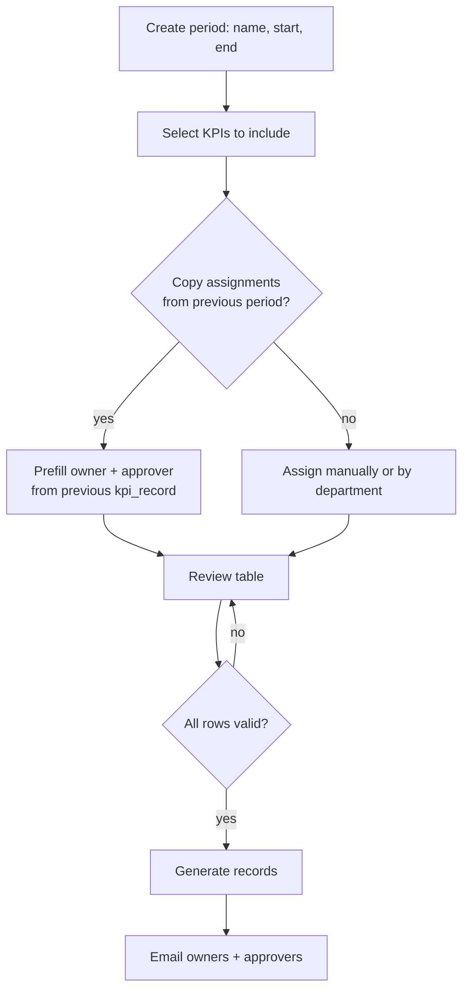
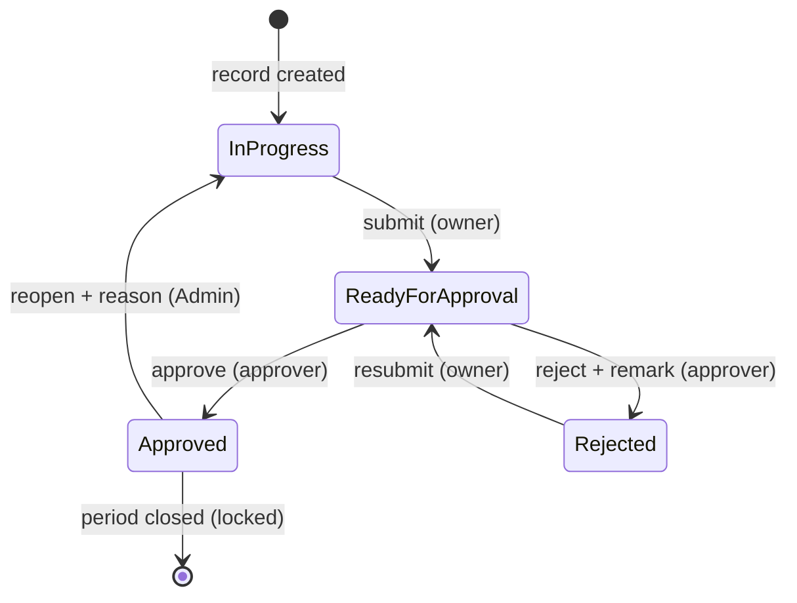
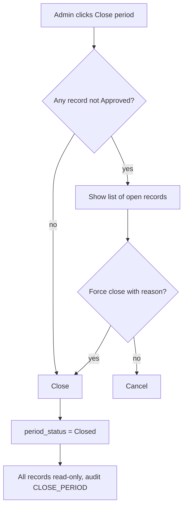
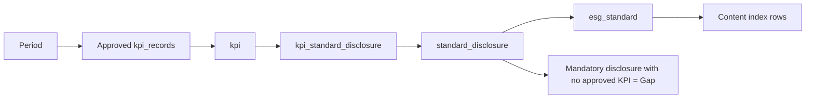

# ESG Management System — Workflow Document

How the system behaves, step by step. Read with `prd.md` (what), `backend.md`
(API, DB) and `frontend.md` (screens).

Conventions: **Actor** = who acts. **Guard** = what must be true or the action
is refused. **Effect** = what the system writes. Every effect that changes data
also writes an `audit_log` row (see §10).

---

## 1. End-to-End Yearly Cycle

| Stage         | Actor          | Screen                       | Output                                |
| ------------- | -------------- | ---------------------------- | ------------------------------------- |
| 0 Setup       | Admin          | Register, Users, Departments | Organisation, people, roles           |
| 1 Master data | Admin          | Standards, KPIs              | Framework and KPI list                |
| 2 Open period | Admin          | New Period wizard            | KPI records with owners and approvers |
| 3 Collect     | Data Owner     | My Tasks → KPI Record        | Value + evidence, submitted           |
| 4 Review      | Approver       | Approval Queue → KPI Record  | Approval or rejection                 |
| 5 Lock        | System         | —                            | Approved records read-only            |
| 6 Close       | Admin          | Period detail                | Period `Closed`                       |
| 7 Report      | Admin / Viewer | Reports                      | Content index, CSV/XLSX               |
| 8 Improve     | Admin          | Period wizard                | Next period copies assignments        |

---

## 2. Workflow A — Onboarding an Organisation

**Actor:** first visitor (becomes Admin).

| Step | Action                                                                          | Guard                                                                   | Effect                                                                                                                                                       |
| ---- | ------------------------------------------------------------------------------- | ----------------------------------------------------------------------- | ------------------------------------------------------------------------------------------------------------------------------------------------------------ |
| A1   | Open `/register`                                                                | —                                                                       | —                                                                                                                                                            |
| A2   | Enter organisation name, organisation code, admin display name, email, password | Code unique, email unique, password ≥ 10 chars with upper, lower, digit | —                                                                                                                                                            |
| A3   | Submit `POST /auth/register-organization`                                       | All checks pass                                                         | In **one transaction**: create `organization`; create `app_user` (Admin); create `user_role` (Admin role, `assigned_by_user_id` = self); audit `CREATE` rows |
| A4   | Redirect to Login                                                               | —                                                                       | Success toast                                                                                                                                                |
| A5   | Admin signs in and finds a **Setup checklist** on the dashboard                 | —                                                                       | Checklist: add departments → add users → review standards → add KPIs → create first period                                                                   |

If any step fails the transaction rolls back; no half-created organisation
exists.

---

## 3. Workflow B — Authentication and Session

| Case                                              | Result                                            |
| ------------------------------------------------- | ------------------------------------------------- |
| Wrong email or password                           | 401 `INVALID_CREDENTIALS` (same message for both) |
| Inactive user or inactive organisation            | 403 `ACCOUNT_DISABLED`                            |
| 5 failed logins in 15 minutes from one IP + email | 429 `TOO_MANY_ATTEMPTS`                           |
| Refresh fails                                     | Frontend clears memory and goes to `/login`       |
| Logout                                            | Refresh token revoked, cookie cleared             |

Password reset: `POST /auth/forgot-password` (always 200) → email with one-time
link (30 min) → `POST /auth/reset-password`. All refresh tokens for that user
are revoked.

---

## 4. Workflow C — Master Data Setup (Admin)

Order matters because later items depend on earlier ones.

| Step | Action                       | Key rules                                                                                          |
| ---- | ---------------------------- | -------------------------------------------------------------------------------------------------- |
| C1   | Create departments           | `department_code` unique within organisation                                                       |
| C2   | Create users                 | Email unique system-wide; department optional; temp password emailed, change forced on first login |
| C3   | Assign roles                 | Writes `user_role` with `assigned_by_user_id`, `assigned_at`; duplicate active role refused        |
| C4   | Review pillars               | Seeded E, S, G, GEN; codes locked                                                                  |
| C5   | Create/choose standard       | e.g. `GRI`, version `GRI Standards 2021`, issuing body `Global Reporting Initiative`               |
| C6   | Link standard to pillars     | Writes `standard_pillar` rows                                                                      |
| C7   | Add disclosures              | e.g. `GRI 302-1` "Energy consumption within the organization", mandatory flag                      |
| C8   | Create KPIs                  | Choose pillar, unit, calculation method, frequency                                                 |
| C9   | Map KPI to disclosures       | Writes `kpi_standard_disclosure` rows; one KPI may serve several disclosures                       |
| C10  | Deactivate instead of delete | `is_active=false`. Inactive KPIs are not offered when opening new periods; old records stay        |

**Example KPI mapping**

| KPI code | Name                                 | Pillar | Unit  | Disclosure |
| -------- | ------------------------------------ | ------ | ----- | ---------- |
| ENV-01   | Total electricity consumed           | E      | kWh   | GRI 302-1  |
| ENV-02   | Scope 2 emissions                    | E      | tCO2e | GRI 305-2  |
| ENV-03   | Water withdrawn                      | E      | m³    | GRI 303-3  |
| ENV-04   | Waste recycled                       | E      | %     | GRI 306-4  |
| SOC-01   | Lost-time injury rate                | S      | rate  | GRI 403-9  |
| SOC-02   | Women in management                  | S      | %     | GRI 405-1  |
| GOV-01   | Independent board members            | G      | %     | GRI 2-9    |
| GOV-02   | Employees trained on anti-corruption | G      | %     | GRI 205-2  |

---

## 5. Workflow D — Open a Reporting Period (Admin)

| Step | Action                                  | Guard                                                                                                                                                         | Effect                                                                                                                                                                                                                      |
| ---- | --------------------------------------- | ------------------------------------------------------------------------------------------------------------------------------------------------------------- | --------------------------------------------------------------------------------------------------------------------------------------------------------------------------------------------------------------------------- |
| D1   | `POST /periods`                         | `period_end_date ≥ period_start_date`; name unique within organisation; no other `In Progress` period of same name                                            | Creates `reporting_period`, status `In Progress`; audit `CREATE`                                                                                                                                                            |
| D2   | Choose KPIs                             | Only active KPIs of the organisation                                                                                                                          | —                                                                                                                                                                                                                           |
| D3   | Assign per KPI: Data Owner + Approver   | Both active users of the same organisation; Data Owner holds role Data Owner (or Admin); Approver holds role Approver (or Admin); **Owner ≠ Approver (BR-4)** | —                                                                                                                                                                                                                           |
| D4   | Optional: **Copy from previous period** | Previous period of same organisation                                                                                                                          | Prefills D3 from last period; unknown/inactive users are blanked and highlighted                                                                                                                                            |
| D5   | Optional: **Bulk assign by department** | Department selected                                                                                                                                           | All rows of chosen KPIs get same owner/approver                                                                                                                                                                             |
| D6   | `POST /periods/:id/records`             | All rows valid; no KPI already has a record in this period (BR-7)                                                                                             | Creates one `kpi_record` per KPI: `submission_status='In Progress'`, `actual_value/target_value/baseline_value=null`, `created_at/updated_at=now`. Baseline and target prefilled from previous period's record when present |
| D7   | Notify                                  | —                                                                                                                                                             | One email per Data Owner summarising assigned KPIs and period end date; one per Approver                                                                                                                                    |

Records can be added later to an open period (same endpoint). Reassigning an
owner/approver later is allowed for Admin only while status ≠ `Approved`
(`PATCH /records/:id/assignment`) and is audited.

---

## 6. Workflow E — Collect, Submit, Review (core loop)

### 6.1 State machine

`InProgress` = "In Progress", `ReadyForApproval` = "Ready for Approval" — values
stored exactly as the display strings.

### 6.2 Transition table

| #  | From                  | To                 | Actor      | Endpoint                     | Guards                                                                                            | Effects                                                                                                              |
| -- | --------------------- | ------------------ | ---------- | ---------------------------- | ------------------------------------------------------------------------------------------------- | -------------------------------------------------------------------------------------------------------------------- |
| T1 | —                     | In Progress        | Admin      | `POST /periods/:id/records`  | See D6                                                                                            | Record created                                                                                                       |
| T2 | In Progress, Rejected | same               | Data Owner | `PATCH /records/:id`         | Caller = `data_owner_user_id` (or Admin); period `In Progress`; values valid                      | Updates values; `updated_at`; audit `UPDATE` with previous/new                                                       |
| T3 | In Progress, Rejected | same               | Data Owner | `POST /records/:id/evidence` | Same as T2; file ≤ 10 MB; allowed type; ≤ 10 active files; hash not duplicate on record           | Stores file, hash; creates `evidence`; audit `UPLOAD_EVIDENCE`                                                       |
| T4 | In Progress, Rejected | Ready for Approval | Data Owner | `POST /records/:id/submit`   | `actual_value` not null; ≥1 active evidence; period `In Progress`; approver active and ≠ owner    | Status, `submitted_at=now`; email to approver; audit `SUBMIT`                                                        |
| T5 | Ready for Approval    | Approved           | Approver   | `POST /records/:id/approve`  | Caller = `approver_user_id` (or Admin who is not the owner); caller ≠ owner; period `In Progress` | Inserts `approval` (`Approved`, `reviewed_at`, optional comment); status `Approved`; email to owner; audit `APPROVE` |
| T6 | Ready for Approval    | Rejected           | Approver   | `POST /records/:id/reject`   | Same as T5 + `comments` min 5 chars                                                               | Inserts `approval` (`Rejected`, comment); status `Rejected`; email to owner with remark; audit `REJECT`              |
| T7 | Rejected              | Ready for Approval | Data Owner | `POST /records/:id/submit`   | Same as T4                                                                                        | As T4 (new submission, `submitted_at` refreshed)                                                                     |
| T8 | Approved              | In Progress        | Admin      | `POST /records/:id/reopen`   | `reason` min 5 chars; period `In Progress`                                                        | Status; `submitted_at=null`; audit `REOPEN` with reason; email owner + approver                                      |
| T9 | Any                   | locked             | System     | `POST /periods/:id/close`    | See §7                                                                                            | No transition; writes are refused when period is `Closed`                                                            |

Every other transition returns `409 INVALID_TRANSITION` with the current status
and the allowed actions.

### 6.3 Data Owner — step by step

1. Sign in. Land on **My Tasks** (records where `data_owner_user_id` = me),
   sorted by period end date, `Rejected` first.
2. Open a record. See KPI code/name, pillar, unit, calculation method, mapped
   disclosures, baseline/target, previous period value, status and history.
3. Enter **actual value** (and target/baseline if blank). Unit is shown beside
   the field.
4. **Save draft** any time (`PATCH`). Status stays.
5. Upload **evidence**: drag file, see name, size, hash status. Remove wrong
   files (soft remove).
6. Click **Submit for approval**. The button is enabled only when value and
   evidence exist; server re-checks.
7. If **Rejected**: the red remark banner shows the approver's comment. Fix
   value/evidence, then resubmit.
8. When Approved the form becomes read-only.

### 6.4 Approver — step by step

1. Sign in. Open **Approval Queue** (records where `approver_user_id` = me and
   status = `Ready for Approval`).
2. Open a record. See value, baseline, target, previous period value and %
   change, evidence list with preview/download, and prior approval history.
3. Check: Does the evidence support the number? Is the unit correct? Is the
   change plausible? (Hint banner if the change vs previous period exceeds 50%.)
4. Click **Approve** (optional comment), or **Reject** (remark required).
5. Record leaves the queue. Owner is notified.

### 6.5 Worked example — electricity (from the research doc)

| Step | Actor | What happens                                                                                                                  |
| ---- | ----- | ----------------------------------------------------------------------------------------------------------------------------- |
| 1    | Admin | Period "FY2026 Q1" opened; ENV-01 assigned to Ravi (Operations) as owner, Meera (Sustainability) as approver                  |
| 2    | Ravi  | Enters actual `10000` kWh                                                                                                     |
| 3    | Ravi  | Uploads `electricity-bill-jan.pdf`                                                                                            |
| 4    | Ravi  | Submits → status `Ready for Approval`, Meera emailed                                                                          |
| 5    | Meera | Opens record, compares bill with value, finds bill shows 12,400 kWh → **Reject**: "Bill total is 12,400 kWh; please correct." |
| 6    | Ravi  | Corrects to `12400`, resubmits                                                                                                |
| 7    | Meera | Approves → locked; `approval` rows: Rejected then Approved                                                                    |
| 8    | Admin | Closes period; ENV-01 appears in the content index under GRI 302-1                                                            |

### 6.6 Edge cases

| Situation                                 | Behaviour                                                                                                  |
| ----------------------------------------- | ---------------------------------------------------------------------------------------------------------- |
| Owner leaves company (user deactivated)   | Records stay; dashboard shows "Unassigned owner" chip; Admin reassigns via `PATCH /records/:id/assignment` |
| Approver deactivated while record waiting | Same; Admin reassigns                                                                                      |
| Two users edit one record                 | Optimistic concurrency: client sends `updated_at`; mismatch → `409 STALE_RECORD`; UI asks to reload        |
| Evidence uploaded then value changed      | Allowed while editable; evidence stays                                                                     |
| All evidence removed after submit         | Blocked: submitted records are not editable                                                                |
| Value 0                                   | Valid. `null` means "not entered"                                                                          |
| Negative values                           | Rejected except KPIs whose unit allows negatives (none in MVP)                                             |
| Double click on Approve                   | Idempotent: second call returns 409 `INVALID_TRANSITION`                                                   |

---

## 7. Workflow F — Close a Period

| Guard                | Detail                                                                                          |
| -------------------- | ----------------------------------------------------------------------------------------------- |
| Caller is Admin      | —                                                                                               |
| Period `In Progress` | Closing twice returns 409                                                                       |
| `force=true`         | Requires `reason` ≥ 5 chars; unfinished records stay with their status and are reported as gaps |

There is no reopen of a closed period in MVP. Corrections go into the next
period as a restatement note on the KPI (Phase 2).

---

## 8. Workflow G — Dashboard and Reporting

### 8.1 Dashboard calculations (per selected period)

| Widget       | Definition                                                                           |
| ------------ | ------------------------------------------------------------------------------------ |
| Total KPIs   | count of `kpi_record` in period                                                      |
| By status    | count grouped by `submission_status`                                                 |
| Completion % | `Approved ÷ Total × 100`                                                             |
| By pillar    | join `kpi.esg_pillar_id` → count by pillar and status                                |
| Overdue      | `period_end_date < today` and status ≠ Approved                                      |
| Table        | KPI, Pillar, Data Owner, Approver, Status, Date Started (`created_at`), Submitted At |

### 8.2 GRI content index (reporting)

| Column                | Source                                                     |
| --------------------- | ---------------------------------------------------------- |
| Standard              | `esg_standard.standard_code` + `version_label`             |
| Disclosure            | `standard_disclosure.disclosure_code` + `disclosure_title` |
| KPI                   | `kpi.kpi_code`, `kpi_name`                                 |
| Value + unit          | `kpi_record.actual_value`, `kpi.unit_of_measurement`       |
| Target / baseline     | `kpi_record.target_value`, `baseline_value`                |
| Data Owner / Approver | joined users                                               |
| Evidence count        | active `evidence`                                          |
| Status                | `Approved` or `Gap`                                        |

### 8.3 Export

Admin or Viewer picks period and format (CSV, XLSX). Only `Approved` records are
included unless `include_all=true` (Admin), in which case a Status column is
added. Each export writes audit `EXPORT`.

### 8.4 Emissions calculator

`Emissions = Activity Data × Emission Factor`

Inputs: scope (1/2/3), activity data, activity unit, emission factor (kg CO2e
per unit). Output: kg and tCO2e (`kg ÷ 1000`). Example:
`10000 kWh × 0.4 = 4000 kg = 4 tCO2e`. Result can be copied into the KPI value.
Factors are user-supplied (illustrative values only).

---

## 9. Workflow H — Notifications

| Event           | Trigger                     | To                                                                        | Content                                       |
| --------------- | --------------------------- | ------------------------------------------------------------------------- | --------------------------------------------- |
| Account created | Admin creates user          | New user                                                                  | Login link, temp password                     |
| Assignment      | D7 / reassignment           | Owner, approver                                                           | List of KPIs, period end date                 |
| Submitted       | T4 / T7                     | Approver                                                                  | KPI, owner, link to record                    |
| Approved        | T5                          | Owner                                                                     | KPI, approver, link                           |
| Rejected        | T6                          | Owner                                                                     | KPI, approver remark, link                    |
| Reopened        | T8                          | Owner, approver                                                           | Reason                                        |
| Reminder        | Daily job 08:00 server time | Owners with `In Progress`/`Rejected`; approvers with `Ready for Approval` | Sent when `period_end_date − today` is 7 or 1 |
| Period closed   | F                           | All owners and approvers                                                  | Summary                                       |

Notification failures never block the transaction: email is queued after commit
and retried 3 times; failures are logged.

---

## 10. Audit Trail Rules

| Rule           | Detail                                                                                                                            |
| -------------- | --------------------------------------------------------------------------------------------------------------------------------- |
| What is logged | Create, update, deactivate, status changes, evidence upload/remove, role assign/revoke, login success/fail, export, period close  |
| Fields         | `user_id`, `entity_name` (collection), `record_id`, `action_name`, `previous_value`, `updated_value` (JSON strings), `created_at` |
| Written when   | Inside the same transaction as the change                                                                                         |
| Immutable      | No update or delete route exists                                                                                                  |
| Visible to     | Admin and Viewer (all); record-level timeline to everyone who can open the record                                                 |
| System actions | Performed by a seeded `system@esg.local` user (reminder job, seed)                                                                |

`action_name` vocabulary: `CREATE`, `UPDATE`, `DEACTIVATE`, `REACTIVATE`,
`LOGIN`, `LOGIN_FAILED`, `ASSIGN_ROLE`, `REVOKE_ROLE`, `UPLOAD_EVIDENCE`,
`REMOVE_EVIDENCE`, `SUBMIT`, `APPROVE`, `REJECT`, `REOPEN`, `CLOSE_PERIOD`,
`EXPORT`, `REASSIGN`.

---

## 11. Permission Matrix

✔ = allowed, ◐ = allowed only on own/assigned items, ✖ = no.

| Capability                                     | Admin | Data Owner    | Approver      | Viewer |
| ---------------------------------------------- | ----- | ------------- | ------------- | ------ |
| Manage organisation, departments, users, roles | ✔     | ✖             | ✖             | ✖      |
| Manage standards, disclosures, KPIs, mappings  | ✔     | ✖             | ✖             | ✖      |
| Read master data                               | ✔     | ✔             | ✔             | ✔      |
| Create / close period, generate records        | ✔     | ✖             | ✖             | ✖      |
| Reassign owner/approver                        | ✔     | ✖             | ✖             | ✖      |
| View dashboard                                 | ✔     | ◐ (own scope) | ◐ (own scope) | ✔      |
| Edit values, upload evidence, submit           | ✔*    | ◐             | ✖             | ✖      |
| Approve / reject                               | ✔*    | ✖             | ◐             | ✖      |
| Reopen approved                                | ✔     | ✖             | ✖             | ✖      |
| View evidence                                  | ✔     | ◐             | ◐             | ✔      |
| Reports and export                             | ✔     | ✖             | ✖             | ✔      |
| Emissions calculator                           | ✔     | ✔             | ✔             | ✔      |
| Audit log                                      | ✔     | ✖             | ✖             | ✔      |

\* Admin acts only when explicitly set as owner/approver of that record, or as a
fallback after reassigning. BR-4 still applies: nobody approves their own
record.

---

## 12. Test Scenarios per Role (acceptance)

| #  | Role       | Scenario                                 | Expected                                   |
| -- | ---------- | ---------------------------------------- | ------------------------------------------ |
| 1  | Admin      | Register org                             | Org + Admin + role exist; atomic           |
| 2  | Admin      | Create period, assign owner = approver   | Rejected `OWNER_EQUALS_APPROVER`           |
| 3  | Data Owner | Submit without evidence                  | 422 `EVIDENCE_REQUIRED`                    |
| 4  | Data Owner | Submit someone else's record             | 403                                        |
| 5  | Approver   | Reject without remark                    | 422 `REMARK_REQUIRED`                      |
| 6  | Approver   | Approve own record                       | 403 `SEGREGATION_OF_DUTIES`                |
| 7  | Data Owner | Edit an Approved record                  | 409 `RECORD_LOCKED`                        |
| 8  | Admin      | Reopen without reason                    | 422                                        |
| 9  | Admin      | Close period with open records           | Blocked with list; force requires reason   |
| 10 | Viewer     | Try POST anywhere                        | 403                                        |
| 11 | Any        | Read another organisation's record by ID | 404                                        |
| 12 | Any        | Upload `.exe` or 11 MB file              | 415 / 413                                  |
| 13 | Viewer     | Export                                   | Only Approved rows included                |
| 14 | System     | Reject → fix → resubmit → approve        | Two `approval` rows; audit shows full path |
